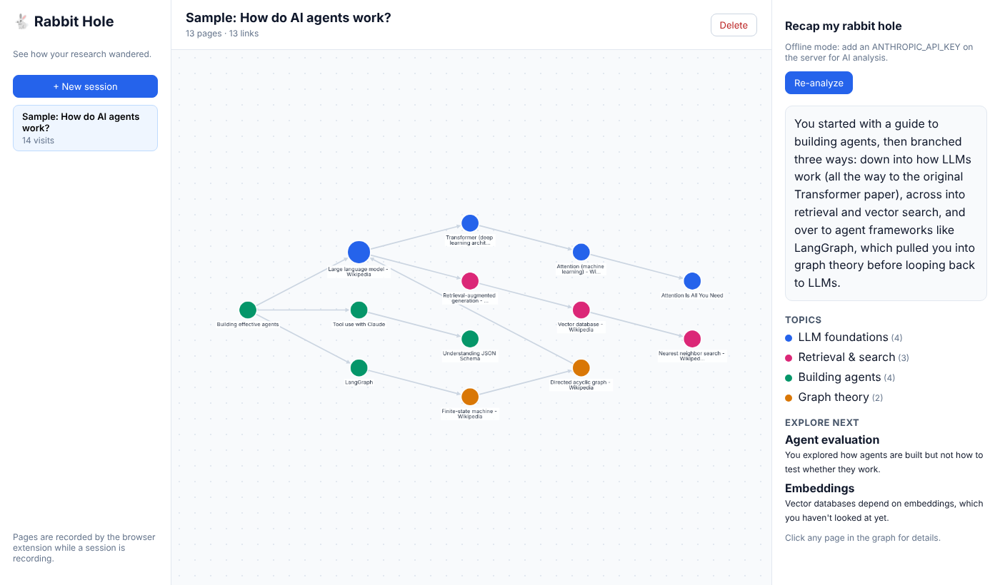

# 🐇 Rabbit Hole Visualizer

Ever start researching one thing and end up 20 tabs deep somewhere completely different?
Rabbit Hole Visualizer records the pages you visit during a research session and turns them into an
**interactive graph** of where you went and how you got there. An **AI agent** then reads your path,
groups the pages into topics, summarizes each page, tells the story of your rabbit hole, and suggests
what to explore next.



**Stack:** React · Node.js / Express · Claude API (tool use) · Cytoscape.js · Chrome Extension (Manifest V3)

---

## How it works

```
 Chrome extension            Node.js + Express API                 React app
 ────────────────            ─────────────────────                 ─────────
 records visits   ──POST──▶  stores sessions & visits   ◀──GET──   interactive graph
 (only while a               builds the graph (code)               topic colors, recap,
  session is on)             runs the Claude agent     ◀──POST──   page details
                              └─ tools: get_session_graph,
                                        get_page_summary,
                                        submit_analysis
                             validates the agent's output (code)
```

1. **Capture:** the extension records each page's URL, title, and the page you came from, but only while a session is recording.
2. **Graph:** the server turns visits into nodes (pages) and edges (clicks between pages). This is plain code, not AI.
3. **Analyze:** a Claude agent runs in a loop. It inspects the graph, fetches pages it needs to understand, then submits topics, page summaries, a recap and "explore next" suggestions through a tool.
4. **Validate:** code checks the agent's answer before saving it: every page ends up in exactly one topic, unknown IDs are dropped, and text lengths are limited.

---

## Run it locally

**Requirements:** Node.js 18+

```bash
# 1. API server
cd server
npm install
cp .env.example .env          # optional: add your ANTHROPIC_API_KEY for AI analysis
npm run dev                   # http://localhost:3001

# 2. React app (new terminal)
cd client
npm install
npm run dev                   # http://localhost:5173
```

The app opens with a **sample session** ("How do AI agents work?") so you can try the graph right away.
Without an API key it uses a simple offline analysis that groups pages by website.

**3. Browser extension**
1. Open `chrome://extensions` and turn on **Developer mode**.
2. Click **Load unpacked** and select the `extension/` folder.
3. Click the extension icon → name your session → **Start recording**, then browse.
4. Watch pages appear live in the React app. Click **Analyze session** when you're done.

**Tests:** `cd server && npm test`

---

## Design decisions

- **The AI reasons, code guarantees correctness.** The graph structure is built by deterministic code, and the
  agent's output goes through `validate.js` before it's saved. The model can't invent pages or leave pages
  without a topic.
- **A real agent loop, not a single prompt.** The agent decides which tools to call and which pages are worth
  fetching, within limits (max 10 turns, max 12 page fetches). It must finish by calling `submit_analysis`,
  which gives structured output instead of free text to parse.
- **Graceful fallback.** If there's no API key or the API call fails, the app still works with an offline
  analysis instead of breaking.
- **Privacy by design.** Nothing is recorded unless you start a session. You can exclude sites (email and
  sign-in pages are excluded by default) and delete sessions. Only URLs, titles and short summaries are
  stored, never full page content.
- **Security.** The page fetcher only allows public `http(s)` URLs and blocks internal network addresses
  (a basic SSRF guard), with timeouts and size limits.
- **Server as the single source of truth.** The extension asks the server which session is active, so starting
  a session from the web app or the extension both work.

## Project structure

```
server/   Express API, graph builder, Claude agent, validation, tests
client/   React + Vite app, Cytoscape graph
extension/ Chrome extension (Manifest V3)
```

## Ideas for next steps

- Swap the JSON file for a real database (PostgreSQL or MongoDB)
- Deploy the API and app to AWS or Azure
- Stream the agent's progress to the UI as it works
- Compare two sessions, or merge related sessions over time
